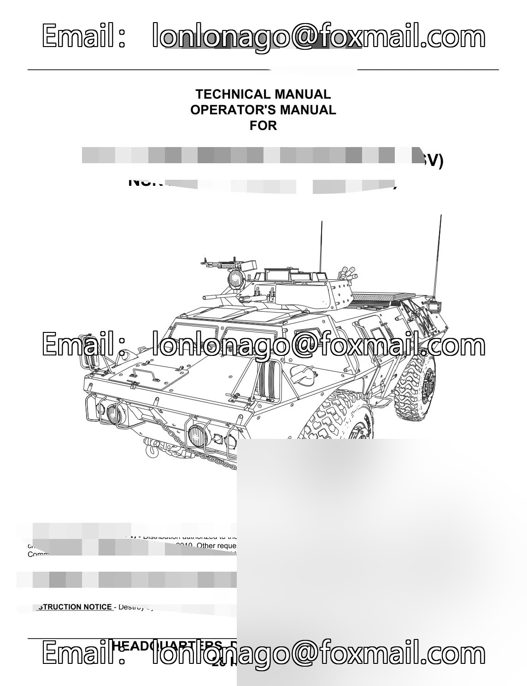
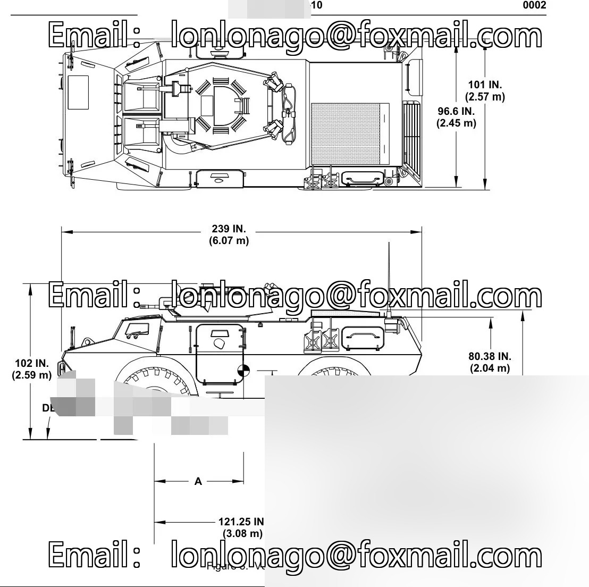
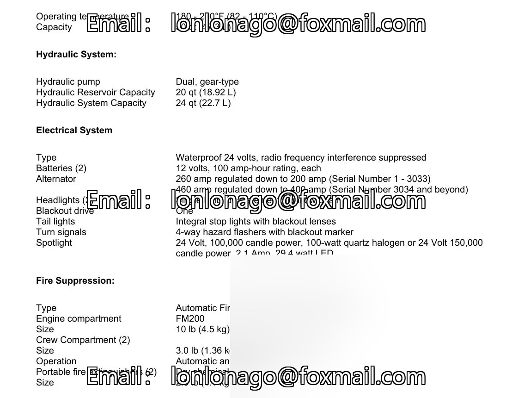
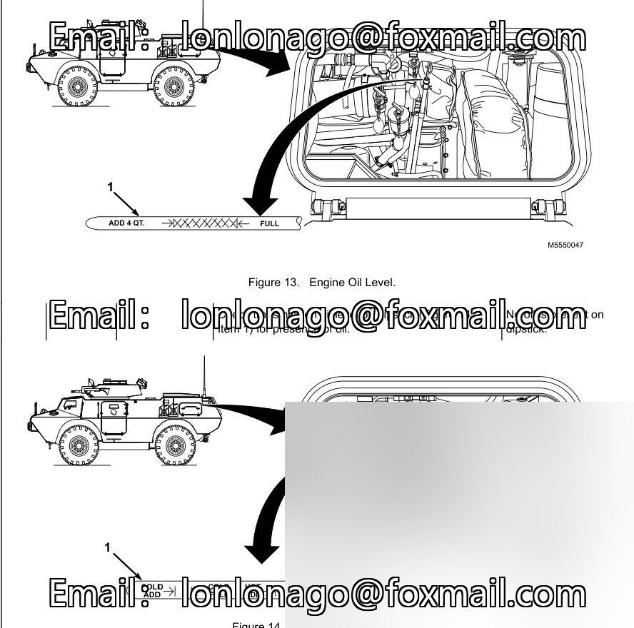
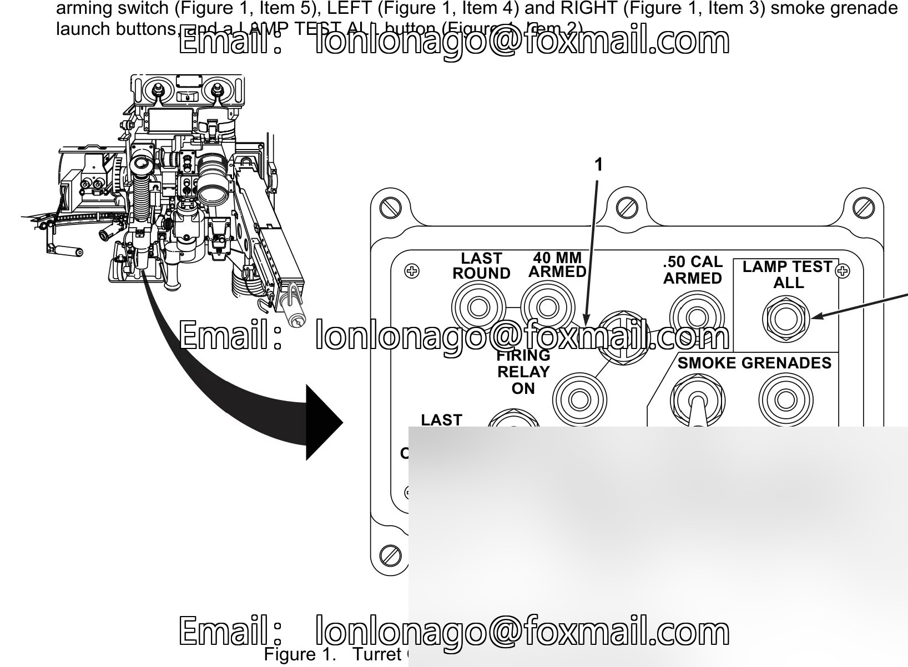

# The M1117 armoured safety vehicle released by the U.S. Army headquarters on November 28, 2014.

## Body

The M1117 Armored Safety Vehicle (ASV) Technical Manual published by the US Army Headquarters on November 28, 2014, in electronic PDF format, not as physical object.

Available only for use by the U.S. Department of Defense and defense contractors Including key technologies Export restricted. Those who violate the law shall be subject to criminal punishment. Content includes vehicle dimensions Hydraulic system Electrical system Fire control system Oil level inspection and other detailed specifications Suitable for military enthusiasts Technical research Strategic analysis reference.

Product sale does not accept returns or exchanges. For direct photography, please communicate privately about issues.

This is the M1117 armored safety vehicle technical manual released by the US Army Headquarters on November 28, 2014, covering technical manual, operator manual, and construction notice.

<!-- AI_ENRICHED -->

## Images

## Payment

Here is a pay link on Stripe ( https://buy.stripe.com/3cs8yP7sY87d0vu9AB ). Please contact me lonlonago@foxmail.com after funding $89, and I will send you a complete data files , thank you!

